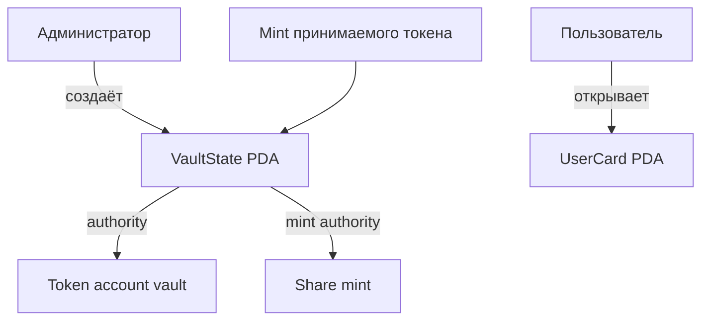

# Liquidity Vault — наша работа за неделю 8

Мы взяли учебный шаблон на Anchor и подготовили основу vault для SPL-токенов. На этой неделе программа создаёт настройки vault, PDA-хранилище токенов, share mint и отдельную карточку пользователя. Депозита пока нет: средства ещё не переводятся.

Контракт написан на Anchor 0.31.1. Версия SBF toolchain Solana закреплена в `Anchor.toml`, а `Cargo.lock` фиксирует Rust-зависимости для сборки.

## Что умеет наша программа

- `initialize_vault` создаёт аккаунт настроек `VaultState`, token account для хранения средств и mint будущих share-токенов.
- `create_user_card` создаёт PDA-карточку пользователя для выбранного vault.
- Инструкции депозита и вывода появятся в следующих версиях.

### Задание 8: vault и PDA-карточка

Администратор выбирает mint принимаемого токена и создаёт vault. В настройках хранятся адреса администратора, mint, token account и share mint, а также общий объём внесённых средств.

Карточка пользователя вычисляется из seeds `user_card`, адреса vault и публичного ключа пользователя. Поэтому для одного пользователя и одного vault получается один постоянный PDA-адрес, и отдельный список пользователей хранить не нужно.

| Аккаунт | Что в нём хранится | Владелец / authority |
|---|---|---|
| `VaultState` | Администратор, mint токена, адреса хранилища и share mint, общий объём депозитов | Программа; адрес — PDA |
| Token account vault | SPL-токены пользователей | SPL Token Program; authority — PDA `VaultState` |
| Share mint | Mint для токенов-квитанций | Mint authority — PDA `VaultState` |
| `UserCard` | Адрес vault, владелец карточки, сумма депозитов | Программа; адрес — PDA |

Схема аккаунтов:



PDA не имеет приватного ключа. Когда программе нужно действовать от имени vault, она использует seeds и bump для подписи CPI. У администратора нет отдельного ключа от token account vault.

## Как запустить

Нужны Rust stable, Node.js 22, Yarn, Solana CLI и Anchor CLI 0.31.1. На Windows мы собирали проект в Ubuntu через WSL2. Установка инструментов описана в [официальной инструкции Solana](https://solana.com/docs/intro/installation) и [инструкции Anchor](https://www.anchor-lang.com/docs/installation).

```bash
git clone --branch week-8 https://github.com/BerikbaiNurai/Solana-course-.git
cd Solana-course-
yarn install
anchor build
```

Чтобы развернуть свою копию в devnet, настройте кошелёк с тестовым SOL, создайте program keypair и обновите program ID:

```bash
mkdir -p target/deploy
solana-keygen new --no-bip39-passphrase -o target/deploy/liquidity_vault-keypair.json
anchor keys sync
solana config set --url devnet
anchor build
anchor deploy --provider.cluster devnet
```

Keypair программы и приватный ключ кошелька не добавляются в Git. После деплоя создайте тестовый mint, настройки vault и карточку:

```bash
ANCHOR_PROVIDER_URL=https://api.devnet.solana.com \
ANCHOR_WALLET="$HOME/.config/solana/id.json" \
yarn setup:devnet
```

Если кошелёк хранится в другом месте, укажите его путь в `ANCHOR_WALLET`. Ветка содержит публичный ID уже развернутой учебной программы; если создать свой program keypair и выполнить `anchor keys sync`, адрес для собственного деплоя будет новым.

## Наша версия в devnet

Мы собрали и развернули программу в devnet. Через Solana RPC проверили, что программа и созданные аккаунты существуют.

| Объект | Explorer |
|---|---|
| Программа | [7deCasDiUCe9D4T4QD8RYMzxMameRDpeE1yZAv4J3o4S](https://explorer.solana.com/address/7deCasDiUCe9D4T4QD8RYMzxMameRDpeE1yZAv4J3o4S?cluster=devnet) |
| Mint принимаемого токена | [3ZF2ErKWGGpZAK4HEWPTgk4kxF95avg5qEKSZS8R7fVm](https://explorer.solana.com/address/3ZF2ErKWGGpZAK4HEWPTgk4kxF95avg5qEKSZS8R7fVm?cluster=devnet) |
| `VaultState` | [5tTHydct51S4mUeP3YHfgVkvv58fVQFQ2gxkbKGMmob6](https://explorer.solana.com/address/5tTHydct51S4mUeP3YHfgVkvv58fVQFQ2gxkbKGMmob6?cluster=devnet) |
| Token account vault | [EQuEpnsP7Ld6tcbrG46ViJ5pMMA76fLnvNvZyyqTLxqp](https://explorer.solana.com/address/EQuEpnsP7Ld6tcbrG46ViJ5pMMA76fLnvNvZyyqTLxqp?cluster=devnet) |
| Share mint | [FxNGzH6bM7u2nNSwR2vMYhhG72wJRQ9DwpCm3kiLpgAp](https://explorer.solana.com/address/FxNGzH6bM7u2nNSwR2vMYhhG72wJRQ9DwpCm3kiLpgAp?cluster=devnet) |
| Карточка пользователя | [4o6tfffq4AFVLXQ5sEMnh9HHeDXmVM83QcSns6hAw8h9](https://explorer.solana.com/address/4o6tfffq4AFVLXQ5sEMnh9HHeDXmVM83QcSns6hAw8h9?cluster=devnet) |

Транзакции: [деплой](https://explorer.solana.com/tx/4Ln7FxDEatQRpbi1yMMvyLeq3Dhrk5cRZk3xN4qT84iH4mL8Q9vQRsZqUcf6AuJu5jbzEVg7Cxd5bTs4Sy9Es8yy?cluster=devnet), [создание vault](https://explorer.solana.com/tx/3mAmGZX9sm7WBQXcC8xWLKQpWGisQakc4JYWk1VSyCxNcGMC55Sw7nfe8oeUMb5fADMAtpf2e3LmBFXCUropns3M?cluster=devnet), [создание карточки](https://explorer.solana.com/tx/363a1iB1H72Rpc3EFtakYSxrYrfc3fSD7kBpkwRHdZfMRJn4L3vGzv8urtZVHG8DBgNjKQDjW2B3NPEMduxrMdwk?cluster=devnet).

## Что мы поняли

- Share mint создаёт программа, потому что mint authority принадлежит PDA vault.
- PDA — адрес без приватного ключа; программа подтверждает подпись через seeds.
- Карточку пользователя можно найти, вычислив её адрес из vault и кошелька.
- На этой неделе мы сделали только каркас. Перевод токенов и выдача shares реализованы в ветке следующей недели.
