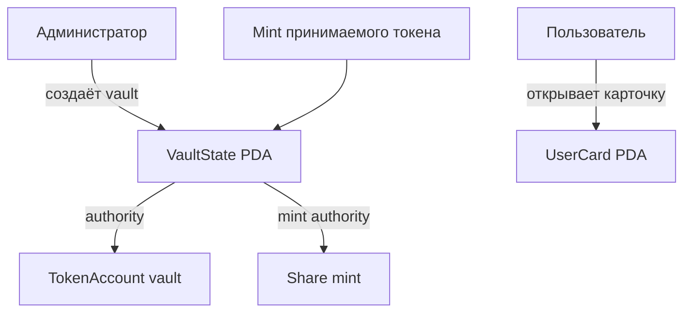

# Неделя 8 — каркас Liquidity Vault

В этой работе я начала собирать учебный vault на Solana. На восьмой неделе я сделала основу: настройки vault, хранилище токенов, mint для будущих share-токенов и отдельную карточку пользователя. Депозита пока нет — токены здесь ещё не переводятся.

## Какие аккаунты я добавила

| Аккаунт | Для чего он нужен | Кто им управляет |
|---|---|---|
| `VaultState` | Хранит администратора, mint принимаемого токена, адреса vault и share mint, общий объём депозитов | Программа; адрес аккаунта — PDA |
| `TokenAccount` | Здесь будут лежать токены, которые внесут пользователи | SPL Token Program, authority — PDA `VaultState` |
| Share mint | Нужен для выпуска токенов-квитанций на следующих неделях | Mint authority — PDA `VaultState` |
| `UserCard` | Хранит адрес vault, владельца карточки и его сумму депозитов | Программа; адрес аккаунта — PDA |

Схема, которую я использовала:



Адреса аккаунтов вычисляются из seeds и program ID:

- Настройки vault: `["vault", token_mint]`
- Хранилище: `["token_vault", token_mint]`
- Share mint: `["share_mint", token_mint]`
- Карточка пользователя: `["user_card", vault_state, user_wallet]`

Поэтому карточку можно найти по адресу пользователя и vault, не сохраняя отдельный список. PDA не имеет приватного ключа: программа проверяет seeds и может подписывать от имени PDA во время CPI.

## Как собрать проект

Я собирала программу в Ubuntu через WSL2. Для этого нужны Rust, Node.js, Yarn, Solana CLI и Anchor CLI 0.31.1. В `Anchor.toml` закреплён SBF toolchain Solana 2.1.0, а `Cargo.lock` фиксирует совместимые Rust-зависимости.

```bash
git clone --branch week-8 https://github.com/BerikbaiNurai/Solana-course-.git
cd Solana-course-
yarn install
anchor build
```

Чтобы развернуть собственную копию программы, нужно настроить devnet-кошелёк с тестовым SOL, создать program keypair и синхронизировать ID. Приватные ключи нельзя добавлять в GitHub:

```bash
mkdir -p target/deploy
solana-keygen new --no-bip39-passphrase -o target/deploy/liquidity_vault-keypair.json
anchor keys sync
anchor build
solana config set --url devnet
anchor deploy --provider.cluster devnet
```

После деплоя создать тестовый mint, настройки vault и свою карточку можно так:

```bash
ANCHOR_PROVIDER_URL=https://api.devnet.solana.com \
ANCHOR_WALLET="$HOME/.config/solana/id.json" \
yarn setup:devnet
```

Если кошелёк хранится по другому пути, нужно поменять `ANCHOR_WALLET`. Ключ администратора и program keypair в репозиторий не загружены. При создании собственного program keypair адрес программы изменится.

## Моя программа в devnet

Я собрала и развернула эту версию программы в devnet, затем проверила, что аккаунты доступны через Solana RPC.

| Что открыть | Адрес |
|---|---|
| Программа | [7deCasDiUCe9D4T4QD8RYMzxMameRDpeE1yZAv4J3o4S](https://explorer.solana.com/address/7deCasDiUCe9D4T4QD8RYMzxMameRDpeE1yZAv4J3o4S?cluster=devnet) |
| Mint принимаемого токена | [3ZF2ErKWGGpZAK4HEWPTgk4kxF95avg5qEKSZS8R7fVm](https://explorer.solana.com/address/3ZF2ErKWGGpZAK4HEWPTgk4kxF95avg5qEKSZS8R7fVm?cluster=devnet) |
| Настройки `VaultState` | [5tTHydct51S4mUeP3YHfgVkvv58fVQFQ2gxkbKGMmob6](https://explorer.solana.com/address/5tTHydct51S4mUeP3YHfgVkvv58fVQFQ2gxkbKGMmob6?cluster=devnet) |
| Хранилище токенов | [EQuEpnsP7Ld6tcbrG46ViJ5pMMA76fLnvNvZyyqTLxqp](https://explorer.solana.com/address/EQuEpnsP7Ld6tcbrG46ViJ5pMMA76fLnvNvZyyqTLxqp?cluster=devnet) |
| Share mint | [FxNGzH6bM7u2nNSwR2vMYhhG72wJRQ9DwpCm3kiLpgAp](https://explorer.solana.com/address/FxNGzH6bM7u2nNSwR2vMYhhG72wJRQ9DwpCm3kiLpgAp?cluster=devnet) |
| Моя карточка `UserCard` | [4o6tfffq4AFVLXQ5sEMnh9HHeDXmVM83QcSns6hAw8h9](https://explorer.solana.com/address/4o6tfffq4AFVLXQ5sEMnh9HHeDXmVM83QcSns6hAw8h9?cluster=devnet) |

Транзакции: [деплой](https://explorer.solana.com/tx/4Ln7FxDEatQRpbi1yMMvyLeq3Dhrk5cRZk3xN4qT84iH4mL8Q9vQRsZqUcf6AuJu5jbzEVg7Cxd5bTs4Sy9Es8yy?cluster=devnet), [создание vault](https://explorer.solana.com/tx/3mAmGZX9sm7WBQXcC8xWLKQpWGisQakc4JYWk1VSyCxNcGMC55Sw7nfe8oeUMb5fADMAtpf2e3LmBFXCUropns3M?cluster=devnet), [создание карточки](https://explorer.solana.com/tx/363a1iB1H72Rpc3EFtakYSxrYrfc3fSD7kBpkwRHdZfMRJn4L3vGzv8urtZVHG8DBgNjKQDjW2B3NPEMduxrMdwk?cluster=devnet).

## Что я поняла на этой неделе

- Share mint создаётся с authority у программы, чтобы пользователь не мог сам выпускать себе квитанции.
- У PDA нет приватного ключа. Программа подтверждает право подписи правильными seeds.
- Карточку конкретного пользователя можно найти, вычислив PDA из адреса vault и публичного ключа пользователя.
- Настройки, хранилище и share mint относятся к одному vault, а карточка создаётся отдельно для каждого пользователя.

На этой неделе я подготовила только основу. Сам перевод токенов и выпуск share-токенов добавлены в следующей версии проекта.

## Ссылки, которыми я пользовалась

- [Установка Solana CLI](https://solana.com/docs/intro/installation)
- [Основы работы с Solana CLI](https://solana.com/docs/intro/installation/solana-cli-basics)
- [Установка Anchor](https://www.anchor-lang.com/docs/installation)
