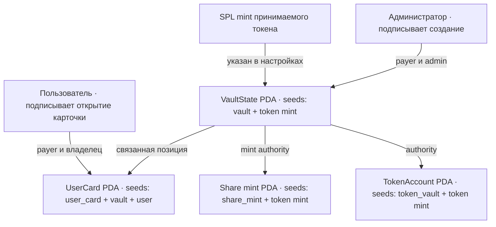

# Liquidity Vault — каркас недели 8

Учебная Anchor-программа для РК1. Она создаёт структуру vault в Solana devnet: настройки, PDA-хранилище принимаемого SPL-токена, mint share-токена и персональную PDA-карточку. Инструкций для депозита и вывода здесь пока нет — на этом этапе средства ещё не перемещаются.

## Схема аккаунтов



| Аккаунт | Владелец / authority | Содержимое |
|---|---|---|
| `VaultState` | программа (PDA) | администратор, mint принимаемого токена, адреса хранилища и share mint, общий внесённый объём, bump |
| `TokenAccount` хранилища | `VaultState` PDA | SPL-токены vault; на неделе 8 баланс остаётся нулевым |
| `Mint` share-токена | mint authority — `VaultState` PDA | receipt-токен с 6 decimals; в этой версии выпуск ещё не открыт |
| `UserCard` | программа (PDA) | vault, владелец, сумма внесённых токенов (пока 0), bump |

PDA не имеет соответствующего приватного ключа. Программа проверяет seeds и bump при каждом доступе. Поэтому только её инструкции смогут подписать CPI от имени `VaultState` для управления токен-аккаунтом и выпуска share-токенов.

## PDA и адреса

- Vault: `["vault", token_mint]`
- Хранилище: `["token_vault", token_mint]`
- Share mint: `["share_mint", token_mint]`
- Карточка: `["user_card", vault_state, user_wallet]`

Карточка пользователя однозначно выводится из адресов vault и кошелька; отдельный список пользователей хранить не нужно. В одном vault для одного кошелька может быть одна карточка.

## Установка инструментов на Windows

Для сборки Solana-программ в Windows используйте WSL2 с Ubuntu. Официальный установщик Solana поддерживает Windows через WSL; команды ниже выполняются в двух разных терминалах.

### 1. Установите WSL2

Откройте PowerShell **от имени администратора** и выполните:

```powershell
wsl --install -d Ubuntu
```

Перезагрузите Windows, если установщик попросит. Откройте Ubuntu из меню «Пуск» и задайте имя и пароль Linux-пользователя.

### 2. Установите Rust, Node.js и инструменты Solana

В терминале Ubuntu:

```bash
sudo apt update
sudo apt install -y build-essential pkg-config libudev-dev libssl-dev curl git

curl --proto '=https' --tlsv1.2 -sSf https://sh.rustup.rs | sh -s -- -y
. "$HOME/.cargo/env"
rustup default stable

curl -o- https://raw.githubusercontent.com/nvm-sh/nvm/v0.40.3/install.sh | bash
. ~/.bashrc
nvm install 22
npm install --global yarn

sh -c "$(curl -sSfL https://release.anza.xyz/stable/install)"
export PATH="$HOME/.local/share/solana/install/active_release/bin:$PATH"
echo 'export PATH="$HOME/.local/share/solana/install/active_release/bin:$PATH"' >> ~/.bashrc

cargo install --git https://github.com/solana-foundation/anchor avm --force
avm install 0.31.1
avm use 0.31.1
```

Закройте и снова откройте Ubuntu, затем проверьте версии:

```bash
rustc --version
node --version
yarn --version
solana --version
anchor --version
```

Ожидаемая версия Anchor CLI — `anchor-cli 0.31.1`.

### 3. Скачайте ветку проекта

```bash
git clone --branch week-8 https://github.com/BerikbaiNurai/Solana-course-.git
cd Solana-course-
yarn install
```

### 4. Создайте program ID и соберите программу

В каталоге проекта создайте отдельный keypair **для адреса программы** и синхронизируйте его адрес с исходным кодом:

```bash
mkdir -p target/deploy
solana-keygen new --no-bip39-passphrase -o target/deploy/liquidity_vault-keypair.json
anchor keys sync
anchor build
```

`anchor keys sync` обновит `declare_id!` в `lib.rs` и адрес программы в `Anchor.toml`. Keypair программы не добавляйте в Git. Это не кошелёк администратора.

### 5. Настройте кошелёк администратора в devnet

Если у вас уже есть Solana keypair, используйте его. Если нет, создайте новый в Ubuntu; сохраните файл в безопасном месте и не отправляйте его никому:

```bash
solana-keygen new
```

Установите devnet как текущий кластер и проверьте, что настроен правильный публичный адрес:

```bash
solana config set --url devnet
solana config get
solana address
solana balance
```

Для учебного деплоя нужен тестовый SOL. Попробуйте получить его:

```bash
solana airdrop 2
```

Если faucet ограничил запросы, используйте [Solana Devnet Faucet](https://faucet.solana.com/). Для devnet используйте только тестовые SOL.

### 6. Задеплойте и создайте аккаунты

```bash
anchor deploy --provider.cluster devnet
yarn setup:devnet
```

Скрипт создаст тестовый SPL mint с 6 decimals, затем vault и карточку администратора. В конце он напечатает адреса аккаунтов и Explorer-ссылки. Чтобы использовать существующий mint, передайте его адрес: `yarn setup:devnet <TOKEN_MINT_ADDRESS>`; mint должен уже существовать в devnet.

Для открытия карточки другого кошелька вызовите `createUserCard` с подписью этого пользователя, PDA `vault_state` и PDA-карточки по seeds выше. Пользователь оплачивает создание собственной карточки.

## Explorer и сдача

После `yarn setup:devnet` откройте напечатанные ссылки на `vault_state`, `token_vault`, `share_mint` и `user_card`. Все ссылки должны вести в devnet.

Ссылки на фактические аккаунты появятся после деплоя и транзакции и зависят от program ID, mint и кошелька. До отправки транзакций таких адресов ещё нет.

## Официальные инструкции

- [Установка Solana CLI и Anchor CLI, включая Windows/WSL](https://solana.com/docs/intro/installation)
- [Установка отдельных зависимостей Solana](https://solana.com/docs/intro/installation/dependencies)
- [Основы Solana CLI: конфигурация сети и кошелёк](https://solana.com/docs/intro/installation/solana-cli-basics)
- [Anchor Version Manager](https://www.anchor-lang.com/docs/installation)

## Что объяснить на защите

- Share mint создаётся с `VaultState` PDA в качестве mint authority: позже программа сможет выпускать квитанции по правилам протокола, а администратор не сможет единолично подделать их.
- PDA вычисляется из seeds и program ID; это адрес без приватного ключа. Программа может подписывать от имени PDA через seeds при CPI.
- Адрес карточки находится повторным вычислением PDA из `vault_state` и публичного ключа пользователя.
- Настройки, токен-хранилище и share mint создаются однократно для каждого mint принимаемого токена. Карточка создаётся отдельно каждым пользователем.
