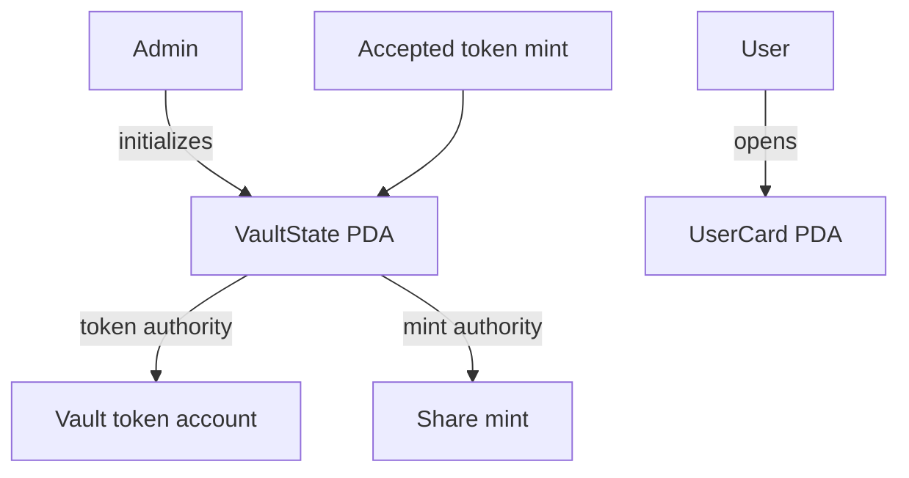

# Liquidity Vault — Week 8: Vault Scaffold

This week I started the Liquidity Vault project from the course Anchor template. I built the basic accounts the vault will need: its settings, a PDA-controlled token account, a share-token mint, and a PDA card for each user. Deposits are not part of this version yet.

The program uses Anchor 0.31.1. I pinned the Solana SBF toolchain in `Anchor.toml` and kept the Rust dependency versions in `Cargo.lock`.

## What I built

- `initialize_vault` creates the `VaultState` settings account, the vault token account, and the share-token mint.
- `create_user_card` opens one deterministic PDA card for a user and a vault.
- Deposit and withdrawal instructions are planned for later weeks.

### How the accounts fit together

The admin chooses the SPL token mint and initializes the vault. `VaultState` stores the admin, accepted token mint, vault token account, share mint, total deposits, and PDA bump.

A user card is derived from `user_card`, the vault address, and the user public key. That gives each user one predictable card for this vault, so the program does not need a list of all users.

| Account | What it stores | Owner or authority |
|---|---|---|
| `VaultState` | Admin, token mint, vault and share-mint addresses, total deposits | Program-owned account at a PDA address |
| Vault token account | SPL tokens deposited into the vault | SPL Token Program; authority is the `VaultState` PDA |
| Share mint | Mint for the receipt tokens | Mint authority is the `VaultState` PDA |
| `UserCard` | Vault, card owner, deposited amount | Program-owned account at a PDA address |

Here is the account layout I used:



A PDA has no private key. When the program needs to act for the vault, it signs a CPI with the PDA seeds and bump. The admin does not have a separate key that can control the vault token account.

## Build and deploy

I used Rust stable, Node.js 22, Yarn, Solana CLI, and Anchor CLI 0.31.1. On Windows I built the project in Ubuntu under WSL2. The official setup guides are [Solana installation](https://solana.com/docs/intro/installation) and [Anchor installation](https://www.anchor-lang.com/docs/installation).

```bash
git clone --branch week-8 https://github.com/BerikbaiNurai/Solana-course-.git
cd Solana-course-
yarn install
anchor build
```

To deploy a separate copy to devnet, I need a devnet wallet with test SOL. I generate a program keypair, sync the program ID, then build and deploy:

```bash
mkdir -p target/deploy
solana-keygen new --no-bip39-passphrase -o target/deploy/liquidity_vault-keypair.json
anchor keys sync
solana config set --url devnet
anchor build
anchor deploy --provider.cluster devnet
```

I do not commit the program keypair or wallet private key. The setup script creates a test mint, initializes the vault, and opens the admin card:

```bash
ANCHOR_PROVIDER_URL=https://api.devnet.solana.com ANCHOR_WALLET="$HOME/.config/solana/id.json" yarn setup:devnet
```

## My devnet scaffold

I built and deployed this version to devnet, then checked that the program and scaffold accounts exist. These are the addresses from my course deployment:

| Account | Explorer |
|---|---|
| Program | [7deCasDiUCe9D4T4QD8RYMzxMameRDpeE1yZAv4J3o4S](https://explorer.solana.com/address/7deCasDiUCe9D4T4QD8RYMzxMameRDpeE1yZAv4J3o4S?cluster=devnet) |
| Accepted token mint | [3ZF2ErKWGGpZAK4HEWPTgk4kxF95avg5qEKSZS8R7fVm](https://explorer.solana.com/address/3ZF2ErKWGGpZAK4HEWPTgk4kxF95avg5qEKSZS8R7fVm?cluster=devnet) |
| `VaultState` | [5tTHydct51S4mUeP3YHfgVkvv58fVQFQ2gxkbKGMmob6](https://explorer.solana.com/address/5tTHydct51S4mUeP3YHfgVkvv58fVQFQ2gxkbKGMmob6?cluster=devnet) |
| Vault token account | [EQuEpnsP7Ld6tcbrG46ViJ5pMMA76fLnvNvZyyqTLxqp](https://explorer.solana.com/address/EQuEpnsP7Ld6tcbrG46ViJ5pMMA76fLnvNvZyyqTLxqp?cluster=devnet) |
| Share mint | [FxNGzH6bM7u2nNSwR2vMYhhG72wJRQ9DwpCm3kiLpgAp](https://explorer.solana.com/address/FxNGzH6bM7u2nNSwR2vMYhhG72wJRQ9DwpCm3kiLpgAp?cluster=devnet) |
| User card | [4o6tfffq4AFVLXQ5sEMnh9HHeDXmVM83QcSns6hAw8h9](https://explorer.solana.com/address/4o6tfffq4AFVLXQ5sEMnh9HHeDXmVM83QcSns6hAw8h9?cluster=devnet) |

Transactions: [program deployment](https://explorer.solana.com/tx/4Ln7FxDEatQRpbi1yMMvyLeq3Dhrk5cRZk3xN4qT84iH4mL8Q9vQRsZqUcf6AuJu5jbzEVg7Cxd5bTs4Sy9Es8yy?cluster=devnet), [vault initialization](https://explorer.solana.com/tx/3mAmGZX9sm7WBQXcC8xWLKQpWGisQakc4JYWk1VSyCxNcGMC55Sw7nfe8oeUMb5fADMAtpf2e3LmBFXCUropns3M?cluster=devnet), and [user-card creation](https://explorer.solana.com/tx/363a1iB1H72Rpc3EFtakYSxrYrfc3fSD7kBpkwRHdZfMRJn4L3vGzv8urtZVHG8DBgNjKQDjW2B3NPEMduxrMdwk?cluster=devnet).

## What I learned

- The program owns the share-mint authority, so only its instructions can issue receipt tokens.
- A PDA is an address derived from seeds and the program ID; it has no private key.
- I can find a user card again by deriving it from the vault and wallet addresses.
- This week is only the vault structure. The deposit and share-minting flow is in [Week 9](https://github.com/BerikbaiNurai/Solana-course-/tree/week-9).
