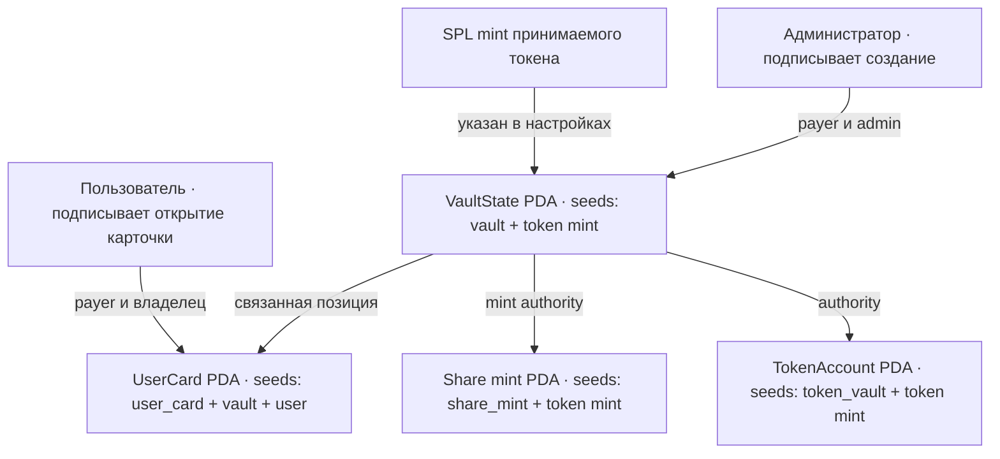

# Liquidity Vault — каркас недели 8

Учебная Anchor-программа для РК1. Она создаёт структуру vault в Solana devnet: настройки, PDA-хранилище принимаемого SPL-токена, mint share-токена и персональную PDA-карточку. Инструкций для депозита и вывода здесь пока нет — на этом этапе средства ещё не перемещаются.

## Схема аккаунтов



| Аккаунт | Владелец / authority | Содержимое |
|---|---|---|
| `VaultState` | программа (PDA) | администратор, mint принимаемого токена, адреса хранилища и share mint, общий внесённый объём, bump |
| `TokenAccount` хранилища | `VaultState` PDA | SPL-токены vault; на неделе 8 баланс остаётся нулевым |
| `Mint` share-токена | mint authority — `VaultState` PDA | receipt-токен с 6 decimals; в этой версии выпуск ещё не открыт |
| `UserCard` | программа (PDA) | vault, владелец, сумма внесённых токенов (пока 0), bump |

PDA не имеет соответствующего приватного ключа. Программа проверяет seeds и bump при каждом доступе. Поэтому только её инструкции смогут подписать CPI от имени `VaultState` для управления токен-аккаунтом и выпуска share-токенов.

## PDA и адреса

- Vault: `["vault", token_mint]`
- Хранилище: `["token_vault", token_mint]`
- Share mint: `["share_mint", token_mint]`
- Карточка: `["user_card", vault_state, user_wallet]`

Карточка пользователя однозначно выводится из адресов vault и кошелька; отдельный список пользователей хранить не нужно. В одном vault для одного кошелька может быть одна карточка.

## Подготовка и devnet

Требуются Rust stable, Solana CLI, Anchor CLI 0.31.1, Node.js 18+ и Yarn.

1. Установите JS-зависимости: `yarn install`.
2. Создайте отдельный program keypair (не кошелёк администратора):

   ```bash
   New-Item -ItemType Directory -Force target/deploy
   solana-keygen new --no-bip39-passphrase -o target/deploy/liquidity_vault-keypair.json
   anchor keys sync
   ```

   Это обновит program ID в `Anchor.toml` и `lib.rs`. Файл keypair исключён из Git.
3. Соберите программу: `anchor build`.
4. Настройте devnet и кошелёк администратора. Адрес кошелька публичный; секретный файл кошелька не добавляйте в репозиторий.

   ```bash
   solana config set --url devnet
   solana balance
   solana airdrop 2
   ```

5. Задеплойте: `anchor deploy --provider.cluster devnet`.
6. Создайте тестовый SPL mint, vault и карточку для кошелька администратора:

   ```bash
   yarn setup:devnet
   ```

   Скрипт создаст mint с 6 decimals и выведет адреса аккаунтов и ссылку на Solana Explorer. Чтобы использовать уже существующий mint, передайте его адрес: `yarn setup:devnet <TOKEN_MINT_ADDRESS>`. В таком случае он должен уже существовать в devnet.

Для другого кошелька вызовите Anchor-инструкцию `createUserCard` с его подписью, `vaultState` и PDA по seeds выше. Создание карточки оплачивает пользователь.

## Explorer и сдача

После `yarn setup:devnet` откройте напечатанную ссылку и замените `/address/<VAULT_STATE>` на адреса `token_vault`, `share_mint` и `user_card`, чтобы посмотреть каждый аккаунт. Все ссылки должны содержать `?cluster=devnet`.

Ссылки на фактические аккаунты появятся после деплоя и транзакции и зависят от program ID, mint и кошелька. До отправки транзакций таких адресов ещё нет.

## Что объяснить на защите

- Share mint создаётся с `VaultState` PDA в качестве mint authority: позже программа сможет выпускать квитанции по правилам протокола, а администратор не сможет единолично подделать их.
- PDA вычисляется из seeds и program ID; это адрес без приватного ключа. Программа может подписывать от имени PDA через seeds при CPI.
- Адрес карточки находится повторным вычислением PDA из `vault_state` и публичного ключа пользователя.
- Настройки, токен-хранилище и share mint создаются однократно для каждого mint принимаемого токена. Карточка создаётся отдельно каждым пользователем.
